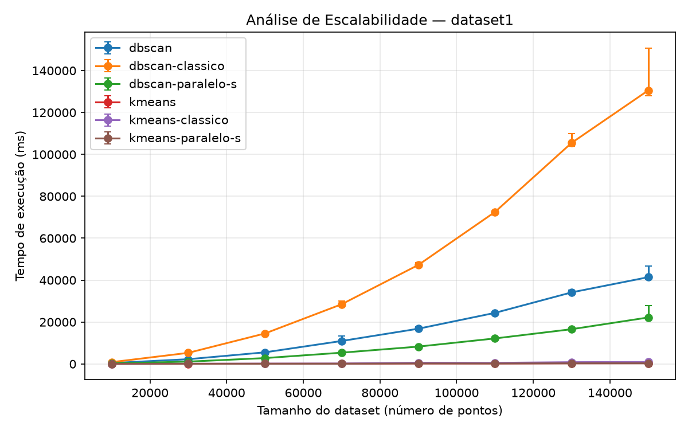
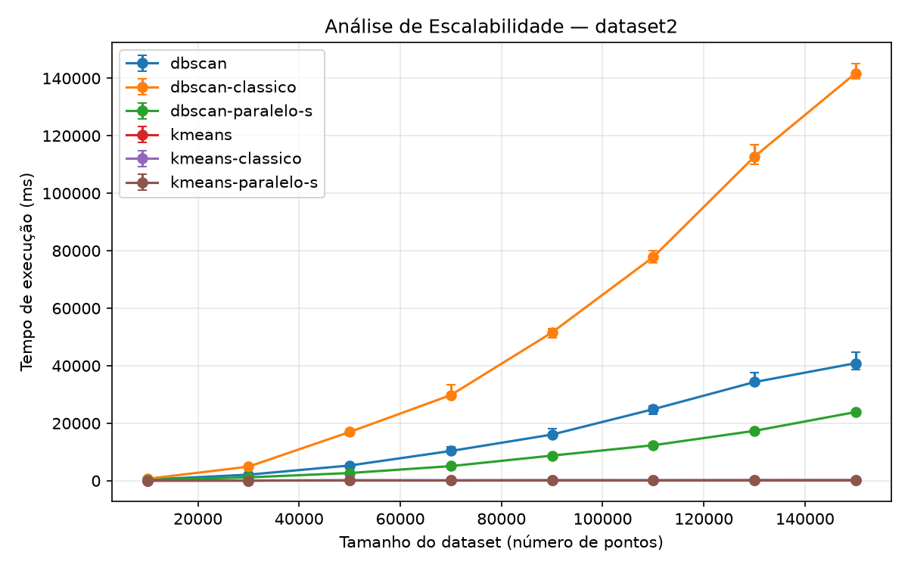
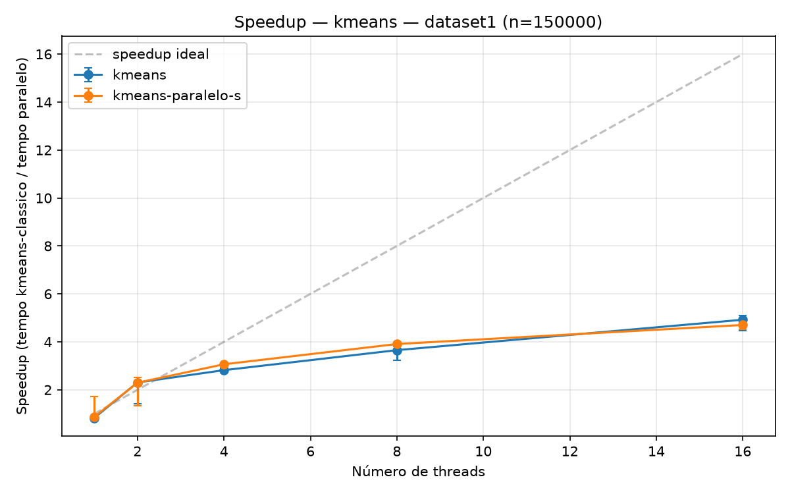
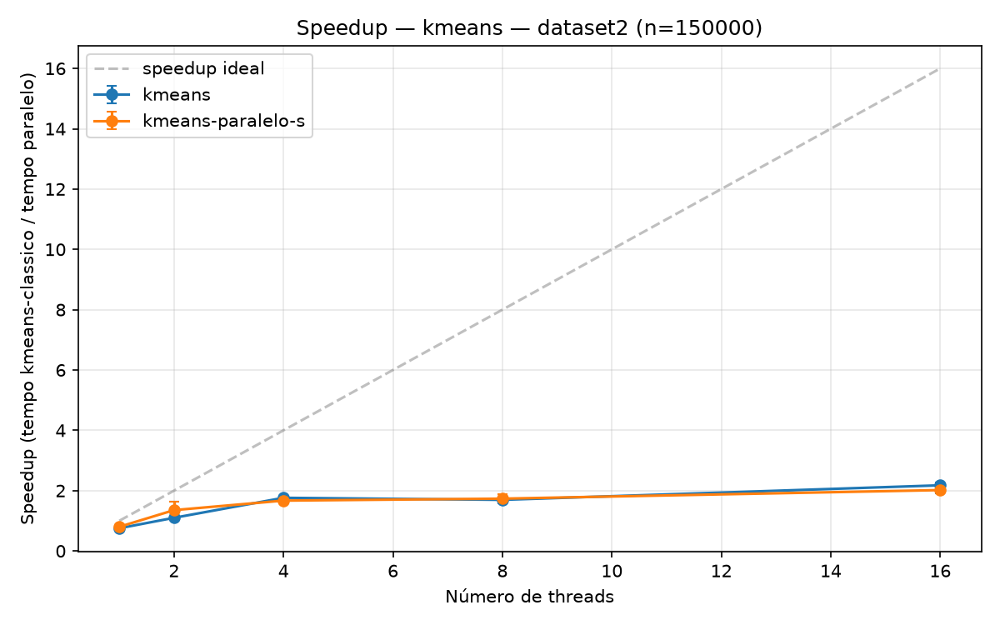
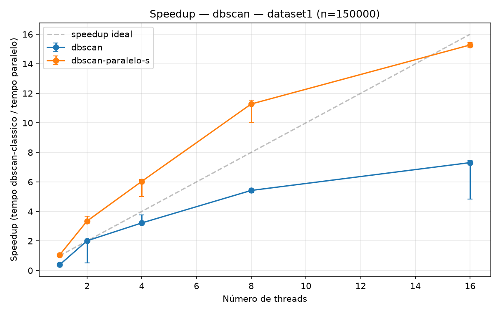
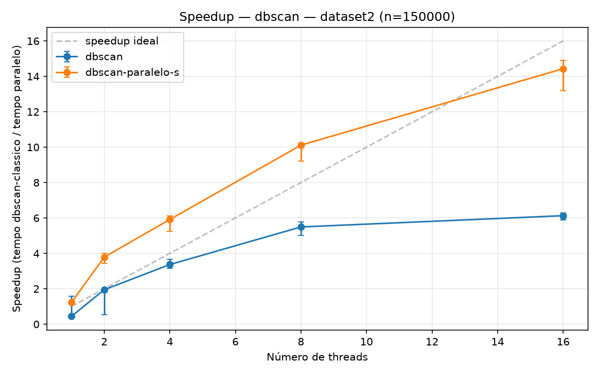

# Experimento 01 — Análise de escalabilidade e speedup

*Documento de trabalho interno do grupo — serve de base para a seção
"Metodologia Experimental e Datasets" e para a discussão de resultados do
relatório final. Não é o texto a ser submetido: o grupo deve reescrever os
pontos relevantes com suas próprias palavras no relatório oficial.*

Dados-fonte: `results/experimento_01/scalability_agregado.csv` e
`results/experimento_01/speedup_agregado.csv` (gerados por
`scripts/aggregate_results.py` a partir de 5 repetições brutas de
`run_scalability_tests.sh` e `run_speedup_tests.sh`). Gráficos em
`results/experimento_01/plots/`.

## 1. Metodologia

- **Hardware:** Intel Core i7-10700F — 8 núcleos físicos, 16 threads lógicas
  (hyperthreading). Mesma máquina, mesmo limite de memória JVM e sem outros
  processos relevantes rodando, em todas as execuções.
- **Datasets:** `dataset1` (8 centros bem separados) e `dataset2` (5 centros
  anisotrópicos), sintéticos via `scikit-learn.make_blobs`, 10.000 a 150.000
  pontos, 2 atributos (x1, x2). Parâmetros calibrados por dataset
  (`k=8`/`k=5` para k-means; `eps=0.2`/`eps=0.15`, `minPts=10` para DBSCAN —
  ver `docs/logs.md`, A-010).
- **Repetições:** cada configuração (algoritmo × dataset × tamanho ou
  threads) foi executada **5 vezes**. Reportamos a **mediana** como valor
  central (mais robusta a outliers que a média) e a faixa **mínimo–máximo**
  como barra de erro nos gráficos — preferível ao desvio-padrão aqui porque
  algumas distribuições são fortemente assimétricas (seção 4).
- **Dois experimentos:**
  - **Escalabilidade** (obrigatório): tempo de execução vs. tamanho do
    dataset (10k–150k, 8 pontos), threads fixas em 4, com os 6 algoritmos
    (3 versões de k-means + 3 de DBSCAN) no mesmo gráfico para fins
    exploratórios.
  - **Speedup** (avaliação adicional opcional): tempo de execução vs. número
    de threads (1, 2, 4, 8, 16), tamanho fixo em n=150.000, comparando cada
    versão paralela contra a respectiva versão clássica sequencial.
    `speedup(threads) = tempo(clássico) / tempo(paralelo, threads)`.

## 2. Escalabilidade (tempo vs. tamanho do dataset)

Crescimento do tempo de execução de 10k para 150k pontos (15x o tamanho),
com threads fixas em 4:

| Algoritmo | dataset1 (10k → 150k) | fator | dataset2 (10k → 150k) | fator |
|---|---|---|---|---|
| kmeans-classico | 31 → 943 ms | 30,4x | 22 → 229 ms | 10,4x |
| kmeans | 56 → 346 ms | 6,2x | 44 → 132 ms | 3,0x |
| kmeans-paralelo-s | 62 → 311 ms | 5,0x | 54 → 135 ms | 2,5x |
| dbscan-classico | 859 → 130.553 ms | 151,9x | 657 → 141.744 ms | 215,7x |
| dbscan | 438 → 41.407 ms | 94,5x | 377 → 40.882 ms | 108,4x |
| dbscan-paralelo-s | 240 → 22.183 ms | 92,4x | 227 → 23.889 ms | 105,2x |

**Observações:**

- **K-means escala quase linearmente** e opera na casa de dezenas a
  centenas de milissegundos mesmo em 150k pontos — complexidade
  O(n·k·iterações) é baixa e dominada pelo número de atributos (2) e de
  clusters (5–8).
- **DBSCAN cresce de forma superlinear em todas as versões**, mas o fator de
  crescimento da versão clássica (~150–215x) é visivelmente pior que o das
  versões paralelas (~90–108x), mesmo com threads fixas em 4 (ou seja, sem
  variar o paralelismo). Isso indica que o ganho das versões paralelas não
  vem só de dividir o mesmo trabalho entre threads: o particionamento
  espacial usado por `dbscan` e `dbscan-paralelo-s` também **reduz o
  trabalho por consulta de vizinhança** (cada thread busca vizinhos dentro
  de uma partição menor, não no dataset inteiro), o que melhora a
  complexidade efetiva do algoritmo, não só sua distribuição entre núcleos.
- Em valor absoluto, no maior tamanho (150k), `dbscan-classico` leva
  ~130–142 s contra ~22–24 s das versões paralelas — mais de 5x mais rápido
  já com apenas 4 threads fixas.

## 3. Speedup (tempo vs. número de threads, n=150.000 fixo)

| Algoritmo / dataset | 1 thread | 2 | 4 | 8 | 16 |
|---|---|---|---|---|---|
| kmeans — dataset1 | 0,83x | 2,30x | 2,82x | 3,65x | 4,92x |
| kmeans-paralelo-s — dataset1 | 0,87x | 2,29x | 3,06x | 3,91x | 4,70x |
| kmeans — dataset2 | 0,75x | 1,10x | 1,76x | 1,69x | 2,18x |
| kmeans-paralelo-s — dataset2 | 0,80x | 1,35x | 1,67x | 1,73x | 2,02x |
| dbscan — dataset1 | 0,39x | 2,01x | 3,22x | 5,42x | 7,31x |
| dbscan-paralelo-s — dataset1 | 1,05x | 3,35x | 6,04x | 11,28x | 15,28x |
| dbscan — dataset2 | 0,44x | 1,94x | 3,37x | 5,49x | 6,13x |
| dbscan-paralelo-s — dataset2 | 1,23x | 3,79x | 5,91x | 10,11x | 14,43x |

(Speedup ideal de referência: igual ao número de threads, ex. 16x em 16
threads.)

**Observações:**

- **K-means tem speedup modesto** (máximo ~4,9x em 16 threads no dataset1,
  ~2,2x no dataset2) — bem abaixo do ideal. A explicação é a própria
  natureza do problema: k-means neste experimento roda em dezenas/centenas
  de milissegundos, então o overhead fixo de criar a thread pool, dividir o
  trabalho e reduzir os resultados passa a pesar proporcionalmente mais à
  medida que se adicionam threads — um caso clássico da Lei de Amdahl, em
  que a fração sequencial fixa limita o ganho possível quando o trabalho
  paralelizável por thread fica muito pequeno.
- **DBSCAN-paralelo-s (lock-free, Patwary) atinge speedup quase ideal**:
  15,28x e 14,43x em 16 threads (ideal = 16x), mostrando que a estratégia de
  Union-Find local por partição + merge via CAS escala quase sem perdas até
  o limite de paralelismo físico da máquina.
- **DBSCAN (lock global, Sofia) escala muito pior**, saturando em ~6-7x
  mesmo em 16 threads — menos da metade do speedup da versão lock-free.
  Isso é esperado: um lock global serializa o acesso à estrutura de
  merge de clusters, criando um gargalo que cresce com o número de threads
  competindo por ele.
- **Speedup < 1x em 1 thread para ambas as versões de DBSCAN**: rodar a
  versão paralela com apenas 1 thread é **mais lento** que a versão
  clássica sequencial (ex. `dbscan` a 1 thread leva 345 s contra 134 s do
  `dbscan-classico` no dataset1). Isso evidencia que a versão paralela
  carrega overhead estrutural fixo (particionamento de dados, criação de
  buffers de arestas entre partições, inicialização de estruturas
  concorrentes) que só compensa a partir de 2+ threads. A versão
  lock-free (`dbscan-paralelo-s`) já em 1 thread fica em torno de 1,0-1,2x
  — ligeiramente mais rápida ou equivalente à clássica — porque o próprio
  particionamento espacial reduz o trabalho de busca de vizinhos mesmo sem
  paralelismo de fato.
- **Speedup superlinear entre 4 e 8 threads no `dbscan-paralelo-s`**
  (dataset1: 6,04x → 11,28x). Fenômeno real e replicável nas 5 repetições
  (ver seção 4), explicado pela combinação de (a) particionamento espacial
  reduzindo o espaço de busca por consulta de vizinhança — ganho
  algorítmico, não só paralelo — e (b) efeito de cache: partições menores
  cabem melhor em cache L2/L3, reduzindo cache misses.
- **Achatamento do ganho entre 8 e 16 threads em todos os algoritmos**:
  consistente com o hardware ter apenas 8 núcleos físicos. De 8 para 16
  threads, o sistema operacional passa a usar os núcleos lógicos extras
  (hyperthreading/SMT), que compartilham unidades de execução com os
  núcleos físicos já ocupados — ganho adicional real, mas bem menor que o
  de núcleos físicos independentes.

## 4. Variabilidade entre repetições (achado metodológico)

Ao agregar as 5 repetições, identificamos variância anormalmente alta em
configurações específicas, que merece registro e cautela na interpretação:

| Configuração | mediana | mínimo | máximo | desvio-padrão |
|---|---|---|---|---|
| `dbscan`, dataset1, 2 threads | 66.803 ms | 65.736 ms | 265.661 ms | 87.712 ms |
| `dbscan`, dataset2, 1 thread | 316.293 ms | 89.525 ms | 323.133 ms | 123.129 ms |
| `dbscan`, dataset2, 2 threads | 72.345 ms | 69.908 ms | 260.654 ms | 100.886 ms |

Em todos os três casos, 4 das 5 execuções ficam próximas da mediana e **uma
única execução** dispara para 3,5–4x o tempo típico — não é ruído
uniforme, é um evento ocasional e raro (provavelmente contenção de lock
sob um padrão específico de agendamento do SO, ou uma pausa de GC em
momento desfavorável). Isso só apareceu na versão `dbscan` **com lock
global** e justamente nas configurações de **menor paralelismo** (1–2
threads) — o oposto do que se esperaria se fosse pura contenção
cresce-com-threads.

Recomendação para o relatório: mencionar essa variabilidade como uma
limitação observada da implementação com lock global (não da lock-free),
e usar a mediana/faixa min-max (não a média) como já fizemos nos gráficos,
exatamente para não deixar esse outlier distorcer a curva reportada.

## 5. Síntese para a seção de resultados do relatório

1. As duas tarefas (k-means e DBSCAN) atendem ao requisito de escalabilidade
   obrigatório: tempo cresce com o tamanho do dataset, medido em 8 pontos
   de 10k a 150k, com 5 repetições por ponto.
2. DBSCAN é a tarefa mais sensível ao paralelismo: ganhos de até ~15x em 16
   threads na versão lock-free, contra ~2–5x em k-means — resultado
   esperado dado que DBSCAN tem complexidade computacional por ponto muito
   maior (busca de vizinhança) que k-means (cálculo de distância a k
   centróides).
3. A comparação lock-based vs. lock-free dentro do próprio DBSCAN é o
   resultado mais forte do trabalho: mesma tarefa, mesma interface, duas
   estratégias de sincronização, com speedup quase 2x maior para a
   abordagem lock-free em alto paralelismo — e isso é justamente o tipo de
   trade-off de design que a disciplina pede para discutir.
4. O hardware de teste (8 núcleos físicos) explica o achatamento do ganho
   acima de 8 threads em todos os algoritmos — não é uma limitação do
   algoritmo, é o teto físico do paralelismo disponível na máquina de
   teste.
