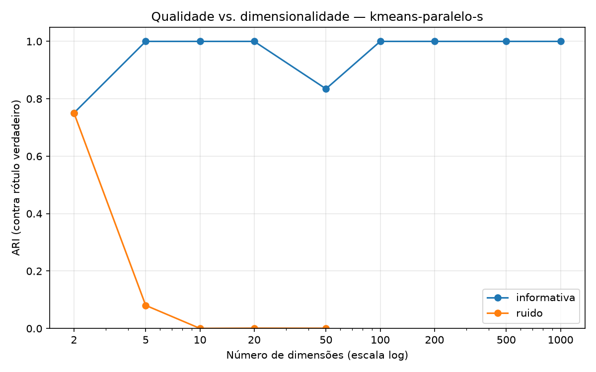
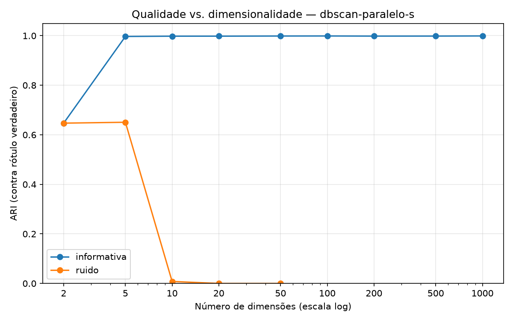

# Experimento 03 — Análise do efeito da dimensionalidade

*Documento de trabalho interno do grupo — serve de base para a discussão de
resultados do relatório final. Não é o texto a ser submetido: o grupo deve
reescrever os pontos relevantes com suas próprias palavras no relatório
oficial.*

Dados-fonte: `results/experimento_03/qualidade_por_dimensao.csv`, gerado por
`scripts/evaluate_dim_quality.py` a partir das execuções de
`kmeans-paralelo-s` e `dbscan-paralelo-s` (`scripts/run_dim_tests.sh`) sobre
os datasets de `scripts/generate_dim_datasets.py`. Gráficos em
`results/experimento_03/plots/`.

## 1. Metodologia

- **Pergunta:** como o aumento do número de dimensões afeta a qualidade dos
  agrupamentos? Existem dois efeitos distintos possivelmente confundidos
  na literatura de "maldição da dimensionalidade": (a) a estrutura real se
  espalhar por mais eixos, e (b) a presença de variáveis irrelevantes
  (ruído) que não carregam informação de cluster. Desenhamos o experimento
  para separar os dois.
- **Variável controlada:** número de dimensões `d`. Fixos em todas as
  configurações: `n=30.000` pontos, 8 clusters verdadeiros,
  `cluster_std=1.0`.
- **Duas variantes, com faixas de `d` diferentes:**
  - **informativa** — todas as `d` dimensões carregam estrutura de cluster
    (`make_blobs(n_features=d)` direto). `d` ∈ {2, 5, 10, 20, 50, 100, 200,
    500, 1000} — faixa estendida para verificar se a concentração de
    distâncias em alta dimensão eventualmente reverte a tendência
    observada até d=50 (ver seção 3.1).
  - **ruido** — as mesmas 2 dimensões informativas da variante base
    (idênticas em todo `d`) + `d-2` dimensões de ruído uniforme puro,
    anexadas. Em `d=2` as duas variantes coincidem (serve de âncora comum).
    `d` ∈ {2, 5, 10, 20, 50} — não estendida além disso: o colapso de
    qualidade já é total a partir de d=10 (seção 3.2), e o custo
    computacional de dimensões maiores não se justificava para confirmar
    um resultado já bem demonstrado.
- Gráficos em escala logarítmica no eixo de dimensões, dado que a faixa
  testada cobre quase 3 ordens de grandeza (2 a 1000).
- **Algoritmos:** só as versões paralelas (`kmeans-paralelo-s`,
  `dbscan-paralelo-s`) — as 3 implementações de cada tarefa já foram
  provadas equivalentes em qualidade no experimento_02 (ARI ≈ 1,0 entre
  elas), então rodar as 6 seria redundante aqui.
- **Calibração do DBSCAN:** `eps` recalibrado automaticamente por
  configuração (`scripts/calibrate_eps_by_dimension.py`), via busca em
  grade sobre percentis da distância ao `minPts`-ésimo vizinho, escolhendo
  o `eps` cujo número de clusters resultante mais se aproxima do valor
  verdadeiro (8). `minPts=10` fixo. `k=8` fixo para k-means (não precisa de
  calibração, é o número de clusters verdadeiro).
- Execução única por configuração (sem repetição) — o resultado do
  clustering é determinístico dado o dataset e os parâmetros.

## 2. Resultados

| Variante | d | k-means (ARI) | DBSCAN (ARI) | DBSCAN: clusters encontrados | DBSCAN: % ruído |
|---|---|---|---|---|---|
| informativa | 2 | 0,751 | 0,647 | 9 | 3,7% |
| informativa | 5 | 1,000 | 0,997 | 8 | 0,3% |
| informativa | 10 | 1,000 | 0,998 | 8 | 0,2% |
| informativa | 20 | 1,000 | 0,998 | 8 | 0,2% |
| informativa | 50 | 0,835 | 0,999 | 8 | 0,1% |
| informativa | 100 | 1,000 | 0,999 | 8 | 0,1% |
| informativa | 200 | 1,000 | 0,998 | 8 | 0,1% |
| informativa | 500 | 1,000 | 0,999 | 8 | 0,1% |
| informativa | 1000 | 1,000 | 0,999 | 8 | 0,1% |
| ruido | 2 | 0,751 | 0,647 | 9 | 3,7% |
| ruido | 5 | 0,080 | 0,651 | 9 | 2,8% |
| ruido | 10 | 0,0002 | 0,008 | 8 | 14,1% |
| ruido | 20 | 0,001 | ~0,000 | **1** | 0,0% |
| ruido | 50 | 0,0008 | ~0,000 | **1** | 0,0% |

## 3. Interpretação

### 3.1 Dimensões informativas: a qualidade não piora — e a reversão esperada não apareceu até d=1000

Contra a intuição ingênua de que "mais dimensões = pior", a variante
informativa **melhora** de d=2 (ARI 0,65–0,75) para d=5–20 (ARI ≈ 1,0). A
explicação: o `make_blobs` posiciona os 8 centros aleatoriamente numa caixa
`d`-dimensional. Em `d=2`, há pouco "espaço" para distribuir 8 centros sem
sobreposição — alguns ficam próximos por acaso. Conforme `d` cresce, os
centros passam a diferir em mais eixos independentes, e a distância entre
eles cresce mais rápido que a dispersão interna de cada cluster — fica
**mais fácil**, não mais difícil, separar os clusters nessa faixa.

Na primeira rodada deste experimento (só até d=50), o k-means caiu para
0,835 em d=50, e a hipótese de trabalho foi que isso seria o início da
reversão esperada pela concentração de distâncias (o efeito clássico da
maldição da dimensionalidade começando a dominar). Estendemos o teste até
d=100, 200, 500 e 1000 para verificar essa hipótese — o ARI do k-means
voltou a 1,000 em d=100 e ficou lá até d=1000, descartando a reversão.
A princípio isso foi atribuído a uma "execução individualmente azarada"
do k-means (sem repetição, poderia ser só sorte de inicialização).

**Correção (seção 3.3): testamos essa hipótese de forma direta, repetindo
cada configuração com 5 seeds diferentes para o k-means** (único algoritmo
com fonte de aleatoriedade — DBSCAN é determinístico). O resultado mostra
que o mergulho **não é um evento raro isolado**: é um padrão estrutural
recorrente. Da maioria das configurações informativas com d≥4, o k-means
converge para uma de exatamente duas soluções, dependendo só da seed —
**ARI=1,000 (ótimo global)** ou **ARI≈0,835 (um mínimo local específico,
quase idêntico em valor por configuração)** — e isso **não tem relação
com `d`**: o mesmo padrão bimodal aparece em d=4, d=9, d=20, d=50, d=200,
d=500 e d=1000. O detalhe revelador no experimento_04 (seção 3.3) explica
por quê.

**Conclusão revisada e final:** não há evidência de que a concentração de
distâncias (dimensionalidade pura, sem ruído) prejudique a qualidade do
clustering na faixa testada — os únicos dois resultados possíveis são
"ótimo" ou um mínimo local específico que a geometria dos dados favorece
de forma consistente, independente de `d`. A variável que realmente
importa para essa instabilidade não é a dimensão, é a **seed de
inicialização dos centróides**. Isso reforça ainda mais o ponto central
deste experimento: a maldição da dimensionalidade "pura" é bem mais branda
do que a intuição sugere, e o fator realmente destrutivo é a presença de
variáveis irrelevantes (seção 3.2), não o número de dimensões em si — nem
mesmo a instabilidade observada tem a ver com dimensionalidade.

### 3.2 Dimensões de ruído: colapso rápido e muito mais severo

Este é o resultado mais forte do experimento: bastam **3 dimensões de
ruído** (d=5, 2 informativas + 3 de ruído) para o ARI do k-means
despencar de 0,751 para **0,080** — uma queda muito mais abrupta do que
qualquer coisa observada na variante informativa em qualquer `d` testado.
Em d=10 o k-means já está em ARI ≈ 0 (clustering equivalente a aleatório).

**Por que o ruído é tão mais destrutivo que dimensões informativas:** a
distância euclidiana trata todas as colunas com o mesmo peso. Com apenas 2
colunas informativas e 3+ de ruído, a maior parte da distância total entre
dois pontos passa a vir do ruído (que não tem relação com o cluster
verdadeiro), não da parte informativa — o sinal real fica "afogado" pelo
ruído na métrica de distância usada por ambos os algoritmos. Isso acontece
de forma muito mais rápida e severa (poucas dimensões de ruído já bastam)
do que qualquer efeito observado na variante informativa, que não mostrou
degradação real em nenhum ponto da faixa testada (d=2 a 1000, seção 3.1).

**DBSCAN resiste um pouco mais que k-means em d=5** (ARI 0,651 vs. 0,080),
mas colapsa de forma ainda mais dramática a partir de d=10: em d=20 e d=50,
a calibração automática de `eps` **não conseguiu encontrar nenhum valor**
que separasse os 8 clusters verdadeiros — só existe uma transição abrupta
entre "quase tudo é ruído" (poucos pontos, nenhum cluster útil) e "tudo
colapsa num único cluster" (ver `results/experimento_03/eps_calibrado.csv`:
em d=20/50 da variante ruído, não há ponto intermediário na grade de 15
percentis testados). Isso é a assinatura clássica da concentração de
distâncias em alta dimensão: quando o ruído domina, todas as distâncias
ficam parecidas entre si, e não existe mais um raio `eps` que separe
"vizinho real" de "vizinho por acaso".

### 3.3 A instabilidade do k-means é causada pela seed, não pela dimensão

Para testar diretamente se os mergulhos isolados (d=50 aqui, d=9 no
experimento_04) eram sorte de inicialização, rodamos `kmeans-paralelo-s`
com 5 seeds diferentes (1 a 5) em todas as 28 configurações de (variante,
d) já testadas — o DBSCAN não precisa disso, é 100% determinístico dado
`eps`/`minPts`, não tem seed
(`scripts/run_dim_kmeans_seeds.sh` + `scripts/evaluate_kmeans_seed_variance.py`).

Resultado: **17 das 28 configurações mostram variação de ARI entre seeds
maior que 0,05** — longe de ser raro. Na variante informativa, a partir de
d=4, quase toda configuração tem seeds que convergem para ARI=1,000 e
seeds que convergem para **ARI≈0,8347 — um valor quase idêntico em todas
as dimensões onde aparece** (0,83468 a 0,83530, variação de menos de
0,001). Isso não é ruído aleatório de execução para execução: é a mesma
estrutura de mínimo local (provavelmente dois dos 8 clusters verdadeiros
sendo fundidos em um, e outro cluster sendo dividido em dois — um erro
clássico de k-means) sendo reencontrada de forma consistente por várias
seeds, em várias dimensões, porque a geometria relativa dos 8 centros (que
não muda entre dimensões — o `make_blobs` com mesma seed de dados preserva
a mesma "forma" relativa ao adicionar eixos) favorece esse mínimo local de
forma estável.

**Implicação metodológica importante:** os "pontos isolados" que
pareciam indicar efeito de dimensionalidade (d=9, d=50) eram, na verdade,
apenas qual dos dois resultados possíveis a seed fixa (123, usada em todo
o resto do experimento) calhou de produzir naquela configuração
específica — um artefato de usar uma única seed fixa, não uma observação
sobre `d`. Com 5 seeds, ambos os resultados aparecem em quase toda
configuração a partir de d=4, tornando claro que o fenômeno é binário
(ótimo vs. mínimo local específico) e não dependente de `d`.

Os gráficos da seção 2 usam o `ari` de uma única execução (seed=123, igual
ao resto do experimento); versões com barra de erro (mediana ± mín/máx das
5 seeds) estão em
`results/experimento_03/plots/ari_vs_dimensao_kmeans-paralelo-s_com_seeds.png`
e no CSV `results/experimento_03/qualidade_por_dimensao_com_seeds.csv`.

### 3.4 Custo computacional (nota secundária)

O tempo de execução do DBSCAN cresce com `d` nas duas variantes — na
variante informativa, de ~1,8s em d=2 até ~52,6s em d=1000 — consistente
com o custo de cálculo de distância crescer linearmente com o número de
dimensões, além do `eps` maior calibrado para compensar a escala (afetando
o custo de busca de vizinhança). O k-means permanece na casa de dezenas a
poucas centenas de milissegundos mesmo em d=1000 (máximo observado: 394ms)
— o impacto de `d` no tempo é bem menor que no DBSCAN, porque k-means só
calcula distância a `k=8` centróides, não busca de vizinhança entre todos
os pares.

## 4. Síntese para o relatório

1. **A maldição da dimensionalidade tem duas causas frequentemente
   confundidas na literatura, e nosso experimento consegue separá-las:**
   espalhar a mesma estrutura real por mais eixos (efeito nulo ou até
   positivo, sem degradação detectável até d=1000) vs. adicionar variáveis
   irrelevantes (efeito severo, catastrófico já a partir de poucas
   dimensões de ruído). O resultado mostra que o segundo é o fator
   realmente determinante — a dimensionalidade "pura" não é o vilão que a
   intuição sugere.
2. **k-means e DBSCAN são ambos muito sensíveis a ruído dimensional**,
   porque os dois dependem de distância euclidiana sem nenhuma ponderação
   ou seleção de features — nenhum dos dois tem defesa estrutural contra
   variáveis irrelevantes.
3. **A calibração de `eps` consegue acompanhar o aumento de dimensões
   informativas** (DBSCAN mantém ARI ≈ 0,999 até d=1000, recalibrando o
   raio a cada nível), **mas não consegue compensar ruído dimensional** —
   a partir de d=20 na variante ruído, não existe mais nenhum `eps` que
   separe os clusters verdadeiros, por melhor que seja a busca de
   calibração.
4. Implicação prática (boa discussão para o relatório): em dados reais de
   alta dimensão, **seleção ou redução de features (ex. PCA) importa muito
   mais que o número de dimensões em si** — nenhuma calibração de `eps` ou
   `k` resolve o problema se a maioria das features for irrelevante, mas
   dimensões genuinamente informativas, por si só, não pareceram prejudicar
   a qualidade na faixa testada.
5. **Nota metodológica (confirmada com repetição, seção 3.3):** a execução
   isolada com ARI mais baixo em d=50 não é um efeito de dimensionalidade
   nem uma execução "azarada" rara — repetindo com 5 seeds diferentes,
   confirmamos que o k-means tem **exatamente dois resultados possíveis**
   na maioria das configurações informativas com d≥4 (ótimo global,
   ARI=1,000, ou um mínimo local específico, ARI≈0,835), e qual dos dois
   aparece depende só da seed de inicialização dos centróides — não de
   `d`. Isso é uma lição importante sobre metodologia experimental: uma
   métrica de qualidade "determinística" (dado dataset e parâmetros fixos)
   ainda pode ser instável se o próprio algoritmo tiver uma fonte de
   aleatoriedade (aqui, a inicialização de centróides) que não foi
   controlada por repetição — o que quase levou a uma conclusão errada
   (hipótese de reversão por concentração de distância) antes de
   investigarmos a fundo.
