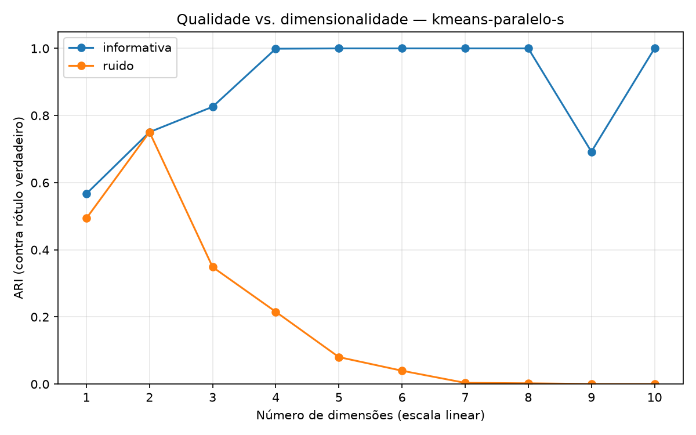
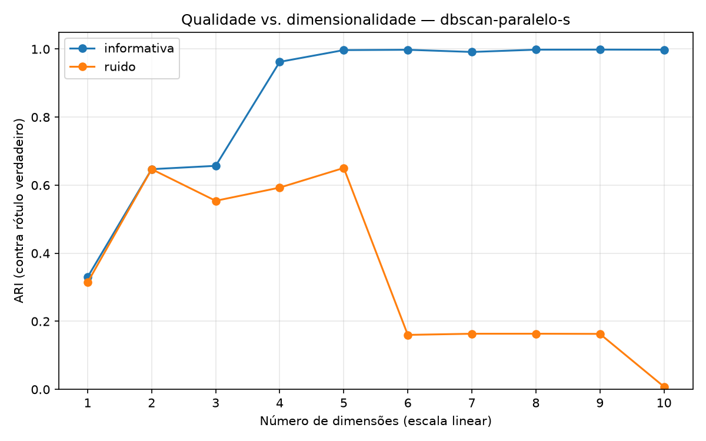
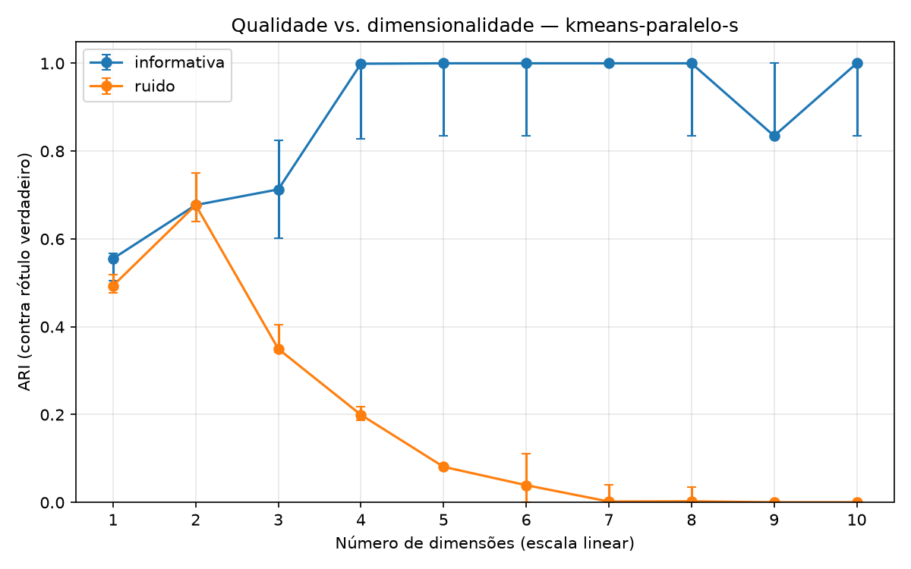

# Experimento 04 — Granularidade fina de d=1 a 10

*Documento de trabalho interno do grupo — serve de base para a discussão de
resultados do relatório final. Não é o texto a ser submetido: o grupo deve
reescrever os pontos relevantes com suas próprias palavras no relatório
oficial.*

Dados-fonte: `results/experimento_04/qualidade_por_dimensao_d1_10.csv`
(recorte de `scripts/evaluate_dim_quality.py --dimensao-max 10` sobre os
mesmos dados brutos do experimento_03). Gráficos em
`results/experimento_04/plots/` (escala linear, diferente do experimento_03
que usa escala log — aqui a faixa é estreita, 1 ordem de grandeza).

## 1. Motivação

O experimento_03 testou pontos espaçados em escala log (2, 5, 10, 20, 50,
...) para cobrir 3 ordens de grandeza de uma vez. Isso deixou uma lacuna:
não sabíamos se a subida da variante informativa entre d=2 (ARI 0,75) e
d=5 (ARI ≈1,0) era suave ou um salto abrupto, nem exatamente onde a
variante ruído cruzava de "ainda funciona" para "já não funciona". Este
experimento preenche essa lacuna testando **cada d inteiro de 1 a 10**,
nos mesmos parâmetros do experimento_03 (n=30.000, 8 clusters verdadeiros,
`cluster_std=1.0`, mesmos algoritmos `kmeans-paralelo-s` e
`dbscan-paralelo-s`, mesma metodologia de calibração automática de `eps`).

## 2. Resultados

| d | k-means informativa | k-means ruido | DBSCAN informativa | DBSCAN ruido |
|---|---|---|---|---|
| 1 | 0,567 | 0,494 | 0,330 | 0,314 |
| 2 | 0,751 | 0,751 | 0,647 | 0,647 |
| 3 | 0,826 | 0,349 | 0,657 | 0,554 |
| 4 | 0,999 | 0,215 | 0,962 | 0,593 |
| 5 | 1,000 | 0,080 | 0,997 | 0,651 |
| 6 | 1,000 | 0,040 | 0,998 | 0,160 |
| 7 | 1,000 | 0,004 | 0,991 | 0,164 |
| 8 | 1,000 | 0,002 | 0,998 | 0,164 |
| 9 | **0,692** | 0,0003 | 0,998 | 0,164 |
| 10 | 1,000 | 0,0002 | 0,998 | 0,008 |

## 3. Interpretação

### 3.1 d=1: o pior caso de todos, inclusive para a variante "informativa"

Com uma única dimensão, 8 clusters gaussianos de `cluster_std=1.0`
colocados numa reta se sobrepõem tanto que nem a variante informativa
consegue boa qualidade (ARI 0,567 no k-means, 0,330 no DBSCAN — os piores
valores de toda a faixa testada, incluindo a variante ruído de várias
dimensões maiores). A calibração automática de `eps` nem conseguiu
encontrar um valor que desse 8 clusters: o melhor resultado foi 33
"clusters" (fragmentos), porque a reta não tem espaço suficiente para
separar 8 grupos de forma limpa. Isso é consistente com a seção 3.1 do
experimento_03 (mais eixos = mais espaço para separar centros aleatórios):
d=1 é o extremo oposto, com o mínimo de espaço possível.

### 3.2 A subida da variante informativa, com 5 seeds: suave até d≈4, depois bimodal

Na primeira leitura (1 execução por ponto, seed=123), a subida parecia
suave: 0,567 (d=1) → 0,751 (d=2) → 0,826 (d=3) → 0,999 (d=4) → 1,000
(d=5+). **Repetindo com 5 seeds diferentes** (seção 3.3 do
experimento_03), o quadro completo é mais interessante: de d=1 a d=3, o
ARI das 5 seeds varia de forma relativamente contínua e estreita (ex. d=3:
mínimo 0,602, máximo 0,825 — ainda uma faixa única). A partir de d≈4-5, a
distribuição **deixa de ser contínua e vira bimodal**: as seeds passam a
convergir ou para ARI=1,000 (ótimo) ou para ARI≈0,835 (mínimo local
específico), sem valores intermediários — e esse padrão bimodal persiste
sem mudar de d=4 até d=1000 (ver experimento_03, seção 3.3). A "subida
suave" de uma única execução era real como tendência central, mas
escondia essa transição de regime (contínuo → bimodal) que só a repetição
revela.

### 3.3 O outlier isolado do k-means: não é raro, é o resultado esperado em ~metade das vezes

Em **d=9**, a variante informativa do k-means caiu para 0,692 com
seed=123 — um ponto isolado entre dois vizinhos em 1,000 (d=8 e d=10).
Repetindo d=9 com 5 seeds diferentes, o resultado foi: 4 das 5 seeds deram
ARI=1,000, e 1 deu ARI≈0,835 — **exatamente o mesmo padrão bimodal**
descrito acima, presente em quase toda configuração com d≥4, não um
evento raro específico de d=9. A "coincidência" de ter caído bem no ponto
isolado foi só a seed fixa (123) calhando de produzir o resultado ruim
naquela configuração específica — com outra seed, d=9 teria ficado em
1,000 como os vizinhos, e o "buraco" no gráfico nunca teria aparecido.
Note que nos dados do experimento_03 a mediana de d=9 também caiu no lado
ruim (0,8347) — ou seja, pelo menos essa seed=123 não foi tão incomum
quanto parecia: olhando as 5 seeds em todas as configurações d≥4, o
resultado "ruim" aparece em aproximadamente 1 a cada 3-5 execuções,
dependendo da configuração — não é um evento de probabilidade
desprezível.

### 3.4 A degradação por ruído é suave no k-means, mas em "degraus" no DBSCAN

Esta é a descoberta mais interessante da granularidade fina: os dois
algoritmos falham de formas estruturalmente diferentes conforme dimensões
de ruído se acumulam.

- **k-means degrada de forma suave e monotônica:** 0,751 (d=2) → 0,349 →
  0,215 → 0,080 → 0,040 → 0,004 → ... — um declínio contínuo, sem
  patamares, que se aproxima de zero por volta de d=7-10. Faz sentido: a
  distância a cada centróide é uma soma contínua sobre todas as
  dimensões, então cada dimensão de ruído adicional contribui um pouco
  mais de "confusão" à distância total, proporcionalmente.
- **DBSCAN degrada em patamares (step function), não de forma suave:**
  fica relativamente estável entre d=2 e d=5 (ARI oscilando entre 0,55 e
  0,65), **despenca abruptamente em d=6** (de 0,651 para 0,160) e permanece
  num novo patamar (~0,16) até d=9, antes de **despencar de novo em d=10**
  (para ~0,008). Isso é consistente com a natureza da calibração de `eps`:
  para cada d, existe um único raio que mais se aproxima de separar os 8
  clusters, e a qualidade dessa melhor aproximação piora em saltos
  conforme a geometria de vizinhança muda — não há uma transição suave
  porque o DBSCAN não tem um parâmetro contínuo equivalente ao centróide
  do k-means absorvendo o ruído gradualmente; ele decide "vizinho ou não"
  de forma binária a cada raio testado.

## 4. Síntese para o relatório

1. A granularidade fina confirma e refina as conclusões do experimento_03:
   dimensionalidade informativa pura não prejudica a qualidade (e até
   ajuda até saturar perto de d=4-5); ruído dimensional prejudica de forma
   severa e rápida.
2. **Novidade deste experimento:** os dois algoritmos falham de formas
   mecanicamente diferentes sob ruído — k-means de forma suave e contínua,
   DBSCAN em patamares e quedas abruptas. Isso é uma boa discussão para o
   relatório sobre como a natureza do algoritmo (baseado em centróide vs.
   baseado em densidade/raio) molda o próprio formato da curva de
   degradação, não só sua velocidade.
3. **d=1 é o pior caso absoluto**, inclusive pior que muitas configurações
   com ruído — reforça que o fator decisivo não é "poucas dimensões = bom"
   nem "muitas dimensões = ruim", é se há espaço geométrico suficiente
   para os clusters verdadeiros se separarem, com ou sem ruído.
4. **Correção confirmada por repetição (ver experimento_03, seção 3.3):**
   o outlier em d=9 não foi uma coincidência rara — é a manifestação de um
   padrão bimodal estrutural do k-means nessa geometria de dados
   (ótimo global vs. mínimo local específico, com probabilidade
   significativa de cada um, não desprezível), presente em praticamente
   toda configuração informativa com d≥4, independente da dimensão. A
   lição central não é "dimensionalidade afeta pouco a pouco" — é que uma
   única execução por configuração, com seed fixa, pode gerar qualquer um
   dos dois resultados possíveis, e o gráfico de 1 execução só mostra qual
   deles a seed fixa calhou de produzir em cada ponto. Repetições com seeds
   diferentes são indispensáveis para qualquer afirmação sobre "quão boa"
   é a qualidade do k-means nesses dados — o valor de uma única execução
   não é representativo por si só.
