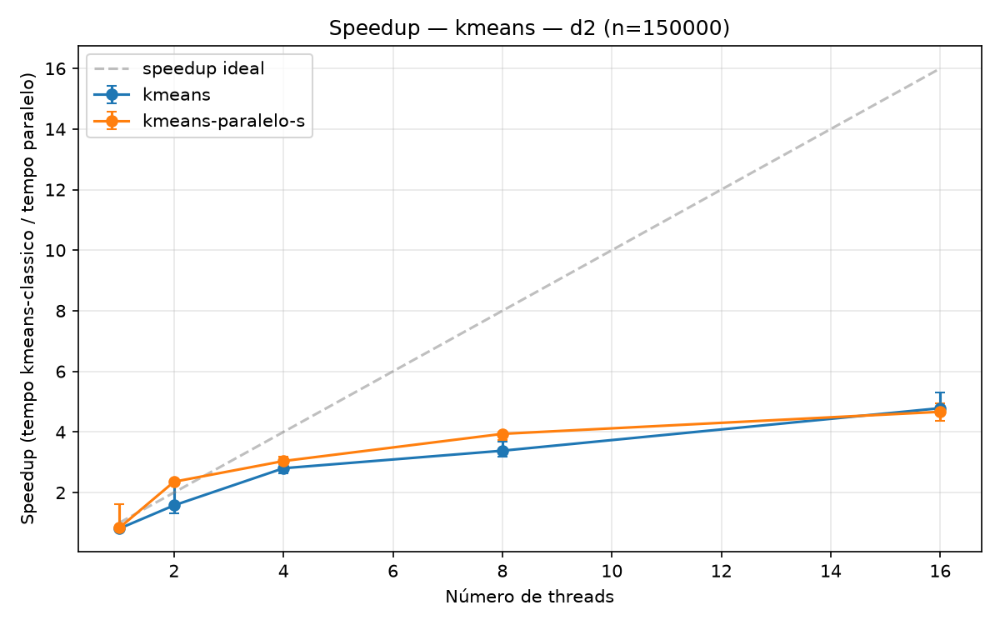
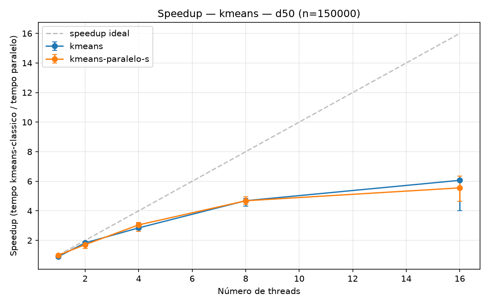
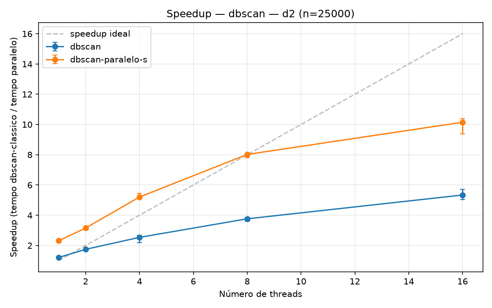
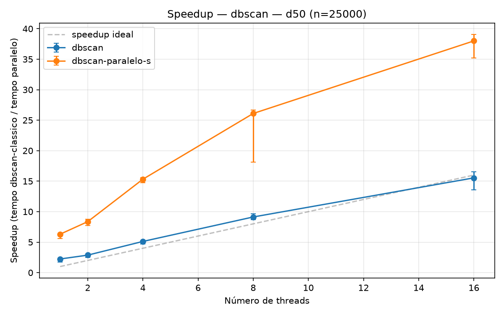

# Experimento 05 — Speedup em função da dimensionalidade

*Documento de trabalho interno do grupo — serve de base para a discussão de
resultados do relatório final. Não é o texto a ser submetido: o grupo deve
reescrever os pontos relevantes com suas próprias palavras no relatório
oficial.*

Dados-fonte: `results/experimento_05/speedup_dim_results.csv` (bruto, 5
repetições por configuração) e `speedup_dim_agregado.csv` (mediana/min/max,
gerado por `scripts/aggregate_results.py`). Gráficos em
`results/experimento_05/plots/`.

## 1. Motivação

O experimento_01 mediu speedup (ganho das versões paralelas sobre a versão
clássica sequencial) variando o número de threads, mas numa única
dimensionalidade (os datasets originais, 2D). Os experimentos_03/04
mostraram que o custo por ponto cresce com a dimensionalidade. A pergunta
deste experimento: **esse aumento de custo por ponto muda a curva de
speedup?** A intuição (lei de Amdahl) é que sim — quanto mais caro for o
trabalho por ponto em relação ao overhead fixo de sincronização entre
threads, maior deveria ser o ganho relativo de paralelizar.

## 2. Metodologia e um ajuste de escopo no meio do caminho

Replica `run_speedup_tests.sh` (experimento_01): mesmos 6 algoritmos
(clássico/paralelo/paralelo-s de k-means e DBSCAN), mesma lista de threads
(1, 2, 4, 8, 16), 5 repetições por configuração — mas variando a
dimensionalidade do dataset (`informativa`, mesma geração do experimento_03)
em vez do dataset.

**Plano original:** d=2, 50, 500, todos em n=150.000 (mesmo n do
experimento_01), para os 6 algoritmos.

**O que aconteceu na prática:** uma medição isolada do `dbscan-classico`
em d=50/n=150.000 (threads=1) levou **22 minutos** — contra ~2 minutos em
d=2. Isso confirma que o custo do DBSCAN cresce de forma muito mais que
linear com d em n grande (consistente com `O(n² · d)`: distância calculada
par-a-par, com `d` operações por par). Extrapolando, d=500 nessa escala de n
levaria a horas por execução; a bateria completa (5 threads × 5 repetições ×
2 variantes paralelas de DBSCAN) se tornaria inviável (dias).

**Ajuste aplicado:**
- **d=500 removido** do experimento — o salto de custo já ficaria claro
  entre d=2 e d=50, e d=500 tornaria o experimento impraticável sem
  acrescentar uma pergunta nova.
- **k-means e DBSCAN passaram a usar tamanhos de dataset diferentes**
  nesta rodada: k-means continua em n=150.000 (rápido, sem problema —
  seu custo é ~O(n·k·d), muito mais barato). DBSCAN passou para
  **n=25.000** (mesma escala já validada nos experimentos_03/04), tornando
  cada execução da ordem de segundos em vez de minutos/horas.
- Essa mudança significa que, **dentro deste experimento**, não é válido
  comparar o tempo absoluto de k-means com o de DBSCAN (tamanhos de entrada
  diferentes) — mas a pergunta do experimento (como o *speedup relativo*
  muda com d, dentro de cada algoritmo) permanece válida, porque o speedup é
  uma razão entre tempos do mesmo algoritmo, no mesmo n, variando só d e o
  número de threads.
- O `eps` do DBSCAN foi recalibrado especificamente para n=25.000 (a
  densidade muda com n), usando a mesma metodologia automática do
  experimento_03 (busca em grade por percentis da distância ao k-ésimo
  vizinho, escolhendo o eps que mais aproxima do número de clusters
  verdadeiro). Ver `scripts/calibrate_eps_speedup.py` e
  `results/experimento_05/eps_calibrado.csv`.

Essa é uma decisão metodológica tomada **durante a execução**, não
planejada — documentada aqui porque é relevante para interpretar os
resultados corretamente no relatório.

## 3. Resultados

Speedup = tempo(versão clássica sequencial) / tempo(versão paralela,
threads). Mediana de 5 repetições.

### 3.1 k-means (n=150.000)

| threads | speedup `kmeans` (d=2) | speedup `kmeans` (d=50) | speedup `kmeans-paralelo-s` (d=2) | speedup `kmeans-paralelo-s` (d=50) |
|---|---|---|---|---|
| 1  | 0,81 | 0,91 | 0,83 | 1,00 |
| 2  | 1,58 | 1,83 | 2,36 | 1,71 |
| 4  | 2,80 | 2,85 | 3,04 | 3,05 |
| 8  | 3,38 | 4,69 | 3,93 | 4,68 |
| 16 | 4,78 | 6,06 | 4,67 | 5,55 |

### 3.2 DBSCAN (n=25.000)

| threads | speedup `dbscan` (d=2) | speedup `dbscan` (d=50) | speedup `dbscan-paralelo-s` (d=2) | speedup `dbscan-paralelo-s` (d=50) |
|---|---|---|---|---|
| 1  | 1,21 | 2,24 | 2,32 | 6,31 |
| 2  | 1,75 | 2,87 | 3,15 | 8,36 |
| 4  | 2,54 | 5,12 | 5,20 | 15,32 |
| 8  | 3,76 | 9,13 | 8,02 | 26,10 |
| 16 | 5,34 | 15,54 | 10,15 | **38,00** |

## 4. Interpretação

### 4.1 A dimensionalidade aumenta o speedup — a hipótese se confirma

Em todos os 4 casos (k-means e k-means-paralelo-s, dbscan e
dbscan-paralelo-s), o speedup a 16 threads é maior em d=50 do que em d=2.
Isso confirma a intuição de Amdahl: com mais dimensões, cada ponto exige
mais trabalho de CPU por comparação/distância, então o overhead fixo de
sincronização entre threads (criação de tarefas, barreiras, locks) pesa
proporcionalmente menos — a fração paralelizável do trabalho total
("fração P" da lei de Amdahl) efetivamente aumenta.

### 4.2 O efeito é pequeno no k-means, dramático no DBSCAN

No k-means, o ganho de d=2 para d=50 é modesto: ~4,7-4,8× → ~5,6-6,1× a 16
threads. Faz sentido — o k-means já é dominado pelo cálculo de distância
ponto-a-centróide (poucas operações por thread, mas também poucos
centróides), então o overhead relativo já era pequeno mesmo em d=2.

No DBSCAN, o efeito é muito maior, especialmente no `dbscan-paralelo-s`
(lock-free, Union-Find com CAS): **10,15× em d=2 → 38,00× em d=50** — um
speedup *superlinear* (acima do número de threads usadas). Isso é o mesmo
fenômeno "acima do ideal" discutido a partir do gráfico do experimento_01
(ver `docs/analise_experimento_01.md`), aqui muito mais acentuado.

### 4.3 Por que speedup superlinear? Não é só paralelismo "puro"

Um speedup de 38× com 16 threads não pode ser explicado só por divisão de
trabalho — o paralelismo ideal máximo com 16 threads é 16×. A explicação
mais provável é um efeito de **cache/localidade de memória**: o
`dbscan-classico` sequencial, processando os 25.000 pontos × 50 dimensões
em um único laço, tem um padrão de acesso à memória que não cabe bem nos
caches L2/L3 da CPU conforme d cresce — cada busca de vizinhos relê uma
fatia grande de dados repetidamente. Já a versão paralela divide os pontos
entre threads, e cada thread trabalha sobre uma fatia menor dos dados, que
cabe melhor no cache daquele núcleo. Ou seja, o "ganho" medido não é só
"16 núcleos fazendo o trabalho de 1" — é também o sequencial pagando uma
penalidade de cache que o paralelo, ao fragmentar os dados, paga bem menos.
Essa é uma leitura razoável, mas não comprovada por profiling de cache
neste experimento (ver seção 5, limitações).

### 4.4 O baseline sequencial de DBSCAN cresce mais rápido com d do que o do k-means

O tempo do `dbscan-classico` (n=25.000) subiu de 6.191ms (d=2) para
63.423ms (d=50) — ~10,2× mais lento para 25× mais dimensões. O
`kmeans-classico` (n=150.000) subiu de 933ms para 4.826ms no mesmo
intervalo de d — ~5,2× mais lento. Os dois crescem sublinearmente em
relação ao fator de 25× em d, mas o DBSCAN cresce cerca do dobro do fator
do k-means, consistente com o custo ~O(n²·d) do DBSCAN força-bruta (que
sofre com n e d multiplicativamente) contra o ~O(n·k·d) do k-means (linear
em d). Essa diferença de sensibilidade a d é a mesma razão pela qual o
plano original (n=150.000, d=500 para DBSCAN) se tornou inviável — e é, por
si só, uma conclusão relevante para o relatório: o custo absoluto do DBSCAN
é mais sensível à dimensionalidade do que o do k-means, independente de
paralelismo.

## 5. Limitações

1. **k-means e DBSCAN não são diretamente comparáveis em tempo absoluto
   neste experimento** (n diferente: 150.000 vs. 25.000) — decisão
   necessária para viabilizar a execução, documentada na seção 2.
2. **Sem d=500**: não sabemos se o efeito observado (speedup crescente com
   d) continua crescendo, satura, ou reverte em dimensões ainda maiores.
3. **A hipótese de cache/localidade (seção 4.3) não foi verificada por
   profiling** (ex. `perf stat`, contadores de cache miss) — é a explicação
   mais plausível dado o padrão observado, mas permanece uma inferência.
4. Mesma ressalva metodológica dos experimentos anteriores: tempos de
   execução em notebook/desktop compartilhado com o sistema operacional,
   sujeitos a ruído de agendamento — mitigado pelas 5 repetições e uso da
   mediana.

## 6. Síntese para o relatório

1. A dimensionalidade muda, sim, a curva de speedup — e na direção prevista
   pela lei de Amdahl: mais trabalho por ponto reduz o peso relativo do
   overhead de sincronização, aumentando o ganho de paralelizar.
2. O efeito é pequeno no k-means (ganho de ~1,3× no speedup máximo entre
   d=2 e d=50) e muito grande no DBSCAN (ganho de ~3,7× no speedup máximo,
   chegando a speedup superlinear de 38× com 16 threads em d=50).
3. **Descoberta adicional, não planejada:** o custo absoluto do DBSCAN é
   mais sensível a d do que o do k-means (~10,2× de aumento no tempo
   sequencial entre d=2 e d=50, contra ~5,2× no k-means) — relevante tanto
   para discutir complexidade assintótica dos dois algoritmos quanto para
   explicar por que o experimento precisou de um ajuste de escopo no meio
   da execução.
